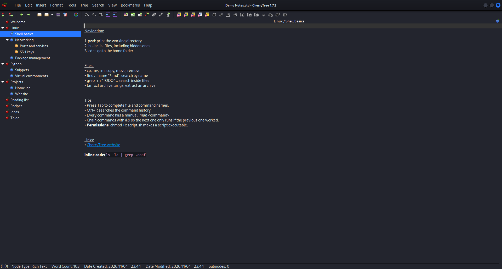
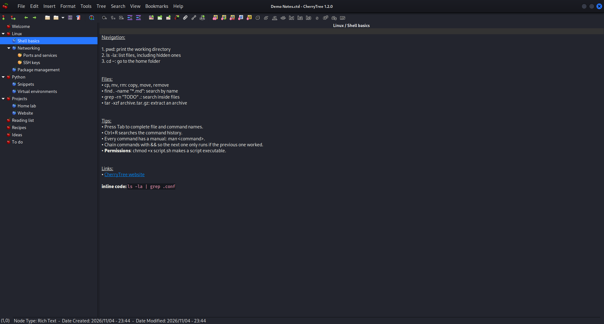
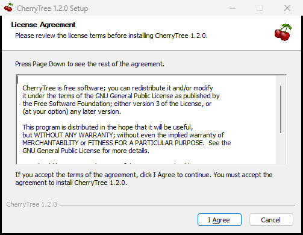

# CherryTree with the Kali Linux™ look, for Windows



This is the real [CherryTree](https://github.com/giuspen/cherrytree) note-taking app (GPL-3.0), not a re-implementation. It's built for Windows and set up to look and behave the way it does on Kali Linux™: the Kali-Dark theme with its dark headerbar and round title buttons, Flat-Remix icons, Cantarell and Fira Code fonts, Linux-style font rendering, and Kali's editor colours. A macOS build is next.

> Unofficial. It isn't made or endorsed by CherryTree's author (Giuseppe Penone), by OffSec or by the Kali Linux project. The official CherryTree for Windows is at [giuspen.net/cherrytree](https://www.giuspen.net/cherrytree/).

## Download

Get the files from **[Releases](https://github.com/Bisaam/cherrytree/releases/latest)**. They need Windows 10 or 11, 64-bit, and no admin rights.

| File | What it is |
|---|---|
| `cherrytree-kali_<version>_win64_setup.exe` | Installer. Installs per user (no admin), adds a Start-menu entry, optionally opens `.ctb/.ctx/.ctd/.ctz` files with CherryTree, and uninstalls cleanly from *Apps & features*. |
| `cherrytree-kali_<version>_win64_portable.zip` | Portable. Unzip anywhere (a USB stick works) and double-click `CherryTree.exe`. Everything it needs is inside the folder. |

Two versions are released:

* **1.7.2**: the latest CherryTree release.
* **1.2.0**: the version Kali Linux ships today.

The files aren't code-signed, so Windows SmartScreen may say "Windows protected your PC". Click *More info*, then *Run anyway*.

Notebooks open both ways between this build and CherryTree on Kali (same `.ctb` / `.ctd` formats).

| | |
|---|---|
|  |  |

## What makes it look like Kali

CherryTree is a GTK3 app, so the "Kali version" isn't a fork. It's stock CherryTree plus what Kali's `kali-themes` package adds around it. This project bundles those same pieces:

| On Kali | Where it comes from | Here |
|---|---|---|
| CherryTree 1.2.0 + Debian patch removing "Check Newer Version" | Debian `cherrytree` package | `patches/<version>/0001-*` |
| Dark editor/tree colours, Cantarell / Fira Code fonts | `kali-themes: /etc/skel/.config/cherrytree/config.cfg` | `kali-look/config/config.cfg`, used as the first-run config |
| `Kali-Dark` editor colour scheme | `kali-themes: share/gtksourceview-4/styles` | `kali-look/styles/` |
| `Kali-Dark` GTK theme (dark headerbar, round title buttons) | `kali-themes: share/themes/Kali-Dark` | `kali-look/themes/`, with the dragon logo in the headerbar replaced by a transparent image (see Licences) |
| `Flat-Remix-Blue-Dark` icons | `kali-themes: share/icons` | `kali-look/icons/` (subset GTK uses) |
| Cantarell 11, Fira Code Medium 10, hintslight + RGB subpixel | Xfce xsettings, `fonts-cantarell`, `fonts-firacode` | `kali-look/fonts/` + fontconfig conf |
| Menubar inside the titlebar, cherry icon left, buttons right | CherryTree Linux default + Xfce decoration layout | `config.cfg [state]`, `gtk-3.0/settings.ini` |

Windows-specific source changes are in `patches/<version>/0002-kali-look.patch`:

* keep settings in their own folder, `%LOCALAPPDATA%\cherrytree-kali`, so a `config.cfg` or `icons\` folder left by a regular CherryTree install can't override the Kali look; on first run it starts from Kali's `config.cfg`
* use fontconfig + FreeType text rendering (`PANGOCAIRO_BACKEND=fc`) so fonts render like on Kali, not like ClearType
* re-apply `etc/gtk-3.0/settings.ini` at application priority, because GTK on Windows otherwise forces the Windows UI font (Segoe UI 9) and full hinting over it
* let the GTK theme draw every titlebar (`GTK_CSD=1`)
* fix the upstream bug where a headerbar window can't be minimised by clicking its taskbar button ([giuspen/cherrytree#1917](https://github.com/giuspen/cherrytree/issues/1917))

`CHERRYTREE_NATIVE_LOOK=1` turns the environment and font overrides off.

`patches/1.2.0/0000-toolchain-compat.patch` backports three upstream fixes 1.2.0 needs on today's MSYS2: `GStatBuf` (GLib 2.90), a missing `windows.h`, and recognising the `ucrt64` install layout. Without the last one CherryTree can't find its own data folder, so styles, the Kali config and language specs go missing.

### Bringing your Kali settings over

The Windows build starts from Kali's defaults (Cantarell 11 notes). If you changed things on Kali, such as a bigger note font via Ctrl+mouse wheel, the toolbar or the tree width, copy `~/.config/cherrytree/config.cfg` from Kali to `%LOCALAPPDATA%\cherrytree-kali\config.cfg` while CherryTree is closed. The recent-file paths inside it point to `/home/kali/...`, so on first start CherryTree may say the last notebook can't be found; open your notebook with File › Open.

## Build it yourself (Windows, driven from WSL)

Prerequisite: [MSYS2](https://www.msys2.org/) at `C:\msys64`:

```powershell
winget install --id MSYS2.MSYS2 -e
```

Then, from this folder in WSL:

```bash
./build-windows.sh --setup                  # first time: updates MSYS2, installs the GTK toolchain, builds 1.2.0
./build-windows.sh --version 1.7.2          # later builds (incremental); any version with a patches/<version>/ set
./build-windows.sh --run                    # build and start it
```

Results land in `dist/` here and in `C:\msys64\opt\cherrytree-kali\release\`. The `release` folder only ever receives finished files: packages are written as `*.partial` and renamed when complete. The build fails if any DLL a packaged binary imports is neither in the package nor part of Windows, so a package that builds runs on a clean PC with nothing on `PATH`.

You can also run `windows/msys2-setup.sh` and `windows/msys2-build.sh` directly in an *MSYS2 UCRT64* terminal.

Both releases need `libxml++-2.6`, which MSYS2 dropped in Oct 2026. The build installs and bundles the last archived package, which was built against the current `libxml2` ABI. The libxml++ flavour is read from each release's own `CMakeLists.txt` (upstream's main branch has moved to `libxml++-5.0`), and the DLL check fails the build if the bundled runtime doesn't match what the binary links against.

## Layout

```
build-windows.sh        WSL driver (syncs to C:\msys64\opt\cherrytree-kali, runs MSYS2)
windows/msys2-setup.sh  MSYS2 packages
windows/msys2-build.sh  fetch tag, patch, build, package (portable zip + NSIS installer)
windows/installer.nsi   installer
windows/launcher/       CherryTree.exe launcher at the top of the portable folder
windows/tests/          PowerShell checks (clean-PATH start, installer, screenshots) + demo notebook
patches/<version>/      source patches
kali-look/              theme, icons, fonts, editor styles, default config
screenshots/
```

## Licences

The build scripts and patches here are GPL-3.0 ([LICENSE](LICENSE)), the same as CherryTree. CherryTree and kali-themes (Kali-Dark theme, Flat-Remix icons, editor styles) are GPL-3.0. Cantarell and Fira Code are under the SIL OFL 1.1 (`kali-look/fonts/LICENSE-*`). Kali Linux™ and the Kali dragon logo are trademarks of OffSec. Kali's EULA asks that modified redistributions replace images containing the trademark, so the dragon in the Kali-Dark headerbar (`kali-look/themes/Kali-Dark/gtk-3.0/assets/kali-headerbar-logo*.png`) is a transparent image here. The name is used only to describe the look this build reproduces, and this project isn't affiliated with OffSec. See [kali-look/COPYRIGHT-kali-themes.txt](kali-look/COPYRIGHT-kali-themes.txt), the [Kali trademark policy](https://www.kali.org/docs/policy/trademark/) and the [EULA](https://www.kali.org/docs/policy/eula/EULA.txt).
