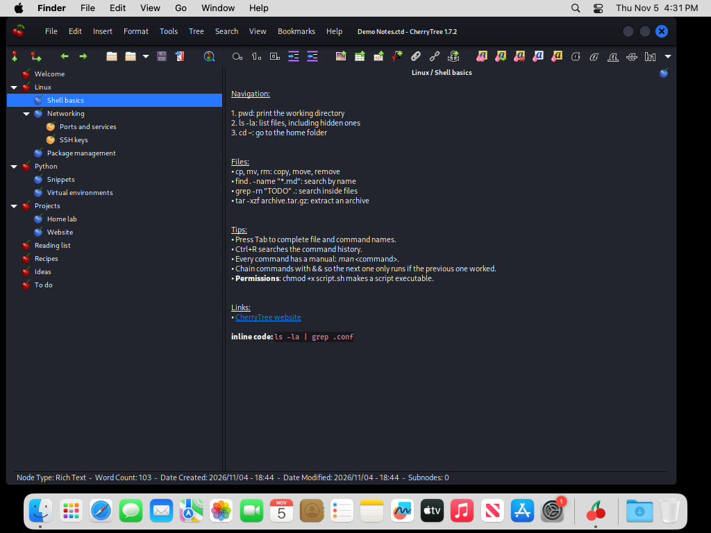

# CherryTree for Windows and macOS


This is the real [CherryTree](https://github.com/giuspen/cherrytree) note-taking app (GPL-3.0), not a re-implementation, built for Windows and macOS. It's set up to look and feel like CherryTree on a Linux desktop:

* the **Cherry-Dark** theme, with a dark headerbar, round title buttons and the menubar inside the titlebar
* **Flat-Remix** icons
* **Cantarell** and **Fira Code** fonts with Linux-style font rendering
* dark editor colours

> Unofficial. It isn't made or endorsed by CherryTree's author (Giuseppe Penone). The official CherryTree is at [giuspen.net/cherrytree](https://www.giuspen.net/cherrytree/).

## Download

| Version | Windows installer | Windows portable | macOS (Apple silicon) |
|---|---|---|---|
| **1.7.2**, the latest CherryTree | [cherrytree_1.7.2_win64_setup.exe](https://github.com/Bisaam/cherrytree/releases/download/v1.7.2/cherrytree_1.7.2_win64_setup.exe) | [cherrytree_1.7.2_win64_portable.zip](https://github.com/Bisaam/cherrytree/releases/download/v1.7.2/cherrytree_1.7.2_win64_portable.zip) | [cherrytree_1.7.2_macos_arm64.dmg](https://github.com/Bisaam/cherrytree/releases/download/v1.7.2/cherrytree_1.7.2_macos_arm64.dmg) |
| **1.2.0**, the version Debian ships | [cherrytree_1.2.0_win64_setup.exe](https://github.com/Bisaam/cherrytree/releases/download/v1.2.0/cherrytree_1.2.0_win64_setup.exe) | [cherrytree_1.2.0_win64_portable.zip](https://github.com/Bisaam/cherrytree/releases/download/v1.2.0/cherrytree_1.2.0_win64_portable.zip) | [cherrytree_1.2.0_macos_arm64.dmg](https://github.com/Bisaam/cherrytree/releases/download/v1.2.0/cherrytree_1.2.0_macos_arm64.dmg) |

All files are also on the [Releases](https://github.com/Bisaam/cherrytree/releases) page, one release per version.

### Windows

Windows 10 or 11, 64-bit, no admin rights needed.

* **Installer**: installs per user, adds a Start-menu entry, optionally opens `.ctb/.ctx/.ctd/.ctz` files with CherryTree, and uninstalls cleanly from *Apps & features*.
* **Portable**: unzip anywhere (a USB stick works) and double-click `CherryTree.exe`. Everything it needs is inside the folder.

The files aren't code-signed, so Windows SmartScreen may say "Windows protected your PC". Click *More info*, then *Run anyway*.

Settings are kept in `%APPDATA%\CherryTree`, separate from a regular CherryTree install, so the two can be used side by side. Notebooks use the normal CherryTree formats (`.ctb` / `.ctd` / `.ctx` / `.ctz`) and open in any CherryTree.

| | |
|---|---|
|  |  |

### macOS

A Mac with Apple silicon (M1 or newer) and macOS 15 Sequoia or newer. Open the `.dmg` and drag CherryTree to Applications. Homebrew's GTK no longer ships Intel builds, so there's no Intel version.

The app isn't notarized by Apple, so the first time macOS says it can't check CherryTree for malware. Try to open it once, then go to *System Settings › Privacy & Security*, scroll down and click *Open Anyway*. Or run `xattr -dr com.apple.quarantine /Applications/CherryTree.app` once in Terminal.

Settings are kept in `~/Library/Application Support/CherryTree`, separate from a Homebrew CherryTree.



## What's in it

| Piece | Here |
|---|---|
| CherryTree 1.2.0 / 1.7.2 from the upstream source, without the "Check Newer Version" menu item (Debian's patch) | `patches/<version>/0001-*` |
| Cherry-Dark GTK theme: dark headerbar, round title buttons | `look/themes/` |
| Cherry-Dark / Cherry-Light editor colour schemes | `look/styles/` |
| Flat-Remix-Blue-Dark icons (the subset GTK uses) | `look/icons/` |
| Cantarell 11, Fira Code Medium 10, hintslight + RGB subpixel rendering | `look/fonts/` + fontconfig conf |
| Default settings: dark tree and editor colours, fonts, menubar in the titlebar | `look/config/config.cfg`, used on first run |

Source changes for Windows and macOS are in `patches/<version>/0002-bundled-look.patch`:

* keep settings in their own folder (`%APPDATA%\CherryTree`, `~/Library/Application Support/CherryTree`), so a `config.cfg` or `icons\` folder left by a regular CherryTree install can't override the look; on first run it starts from the bundled defaults
* use fontconfig + FreeType text rendering (`PANGOCAIRO_BACKEND=fc`) so fonts render like on Linux, not like ClearType
* re-apply `etc/gtk-3.0/settings.ini` at application priority, because GTK otherwise forces the system UI font (Segoe UI 9 on Windows, the macOS system font) and, on Windows, full hinting over it
* macOS: find the data folders inside `CherryTree.app/Contents/Resources`
* let the GTK theme draw every titlebar (`GTK_CSD=1`)
* fix the upstream bug where a headerbar window can't be minimised by clicking its taskbar button ([giuspen/cherrytree#1917](https://github.com/giuspen/cherrytree/issues/1917))

`CHERRYTREE_NATIVE_LOOK=1` turns the environment and font overrides off.

`patches/1.2.0/0000-toolchain-compat.patch` backports three upstream fixes 1.2.0 needs on today's MSYS2: `GStatBuf` (GLib 2.90), a missing `windows.h`, and recognising the `ucrt64` install layout. Without the last one CherryTree can't find its own data folder, so styles, the default settings and language specs go missing.

### Bringing your settings from Linux

To keep the font size, toolbar or tree width you use on Linux, copy `~/.config/cherrytree/config.cfg` to `%APPDATA%\CherryTree\config.cfg` while CherryTree is closed. The recent-file paths inside it point to Linux folders, so on first start CherryTree may say the last notebook can't be found; open your notebook with File › Open. If the editor colours look off afterwards, pick **Cherry-Dark** in Preferences › Rich Text and › Plain Text and Code.

## Build it yourself (Windows, driven from WSL)

Prerequisite: [MSYS2](https://www.msys2.org/) at `C:\msys64`:

```powershell
winget install --id MSYS2.MSYS2 -e
```

Then, from this folder in WSL:

```bash
./build-windows.sh --setup                  # first time: updates MSYS2, installs the GTK toolchain, builds 1.2.0
./build-windows.sh --version 1.7.2          # later builds (incremental); any version with a patches/<version>/ set
./build-windows.sh --run                    # build and start it
```

Results land in `dist/` here and in `C:\msys64\opt\cherrytree\release\`. The `release` folder only ever receives finished files: packages are written as `*.partial` and renamed when complete. The build fails if any DLL a packaged binary imports is neither in the package nor part of Windows, so a package that builds runs on a clean PC with nothing on `PATH`.

You can also run `windows/msys2-setup.sh` and `windows/msys2-build.sh` directly in an *MSYS2 UCRT64* terminal.

## Build it yourself (macOS)

On a Mac with [Homebrew](https://brew.sh):

```bash
macos/build-macos.sh --version 1.7.2        # → dist/cherrytree_1.7.2_macos_arm64.dmg
```

It installs the Homebrew packages, builds CherryTree, and `macos/make_app.py` assembles `CherryTree.app`. Every Homebrew library it loads goes inside the bundle with `@loader_path` references, and the app is signed ad hoc. The build fails if anything still points outside the bundle. GitHub Actions does the same on every push (`.github/workflows/macos.yml`, macOS 15 runners) and also starts the app and takes a screenshot (`macos/tests/smoke-test.sh`).

Both releases need `libxml++-2.6`, which MSYS2 dropped in Oct 2026. The build installs and bundles the last archived package, which was built against the current `libxml2` ABI. The libxml++ flavour is read from each release's own `CMakeLists.txt` (upstream's main branch has moved to `libxml++-5.0`), and the DLL check fails the build if the bundled runtime doesn't match what the binary links against.

## Layout

```
build-windows.sh        WSL driver (syncs to C:\msys64\opt\cherrytree, runs MSYS2)
windows/msys2-setup.sh  MSYS2 packages
windows/msys2-build.sh  fetch tag, patch, build, package (portable zip + NSIS installer)
windows/installer.nsi   installer
windows/launcher/       CherryTree.exe launcher at the top of the portable folder
windows/tests/          PowerShell checks (clean-PATH start, installer, screenshots) + demo notebook
macos/build-macos.sh    macOS build (Homebrew), disk image
macos/make_app.py       CherryTree.app: bundled look, libraries inside, ad-hoc signature
macos/launcher.c        the app's launcher: points GTK, fontconfig and gdk-pixbuf into the bundle
macos/tests/            start + screenshot check used by GitHub Actions
patches/<version>/      source patches
look/                   theme, icons, fonts, editor styles, default settings
screenshots/
```

## Credits and licences

The build scripts and patches here are GPL-3.0 ([LICENSE](LICENSE)), the same as CherryTree.

The Cherry-Dark GTK theme, the Cherry-Dark / Cherry-Light editor schemes, the Flat-Remix-Blue-Dark icons (by Daniel Ruiz de Alegría) and the default settings come from the kali-themes package (GPL-3.0, Copyright Offensive Security; see [look/COPYRIGHT-themes.txt](look/COPYRIGHT-themes.txt)). Here the theme and schemes are renamed, and the theme's headerbar logo is replaced by a transparent image.

The macOS app icon is the CherryTree icon of the Flat Remix icon theme (GPL-3.0). Cantarell and Fira Code are under the SIL OFL 1.1 (`look/fonts/LICENSE-*`).
